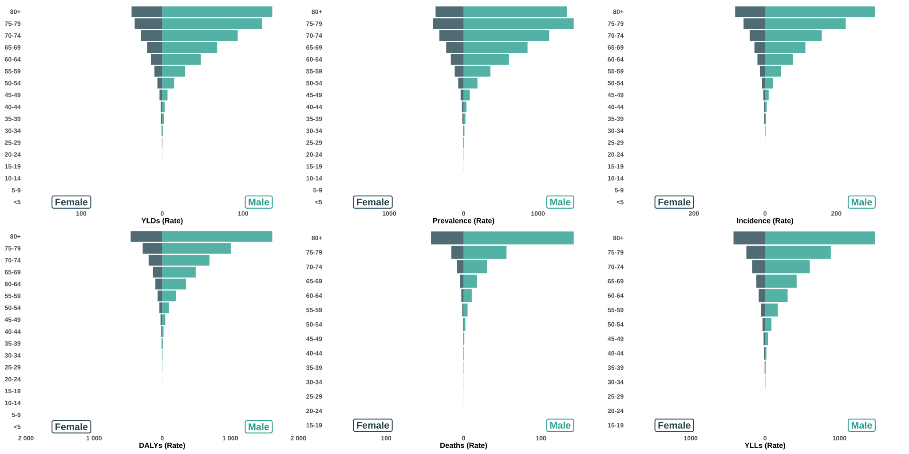
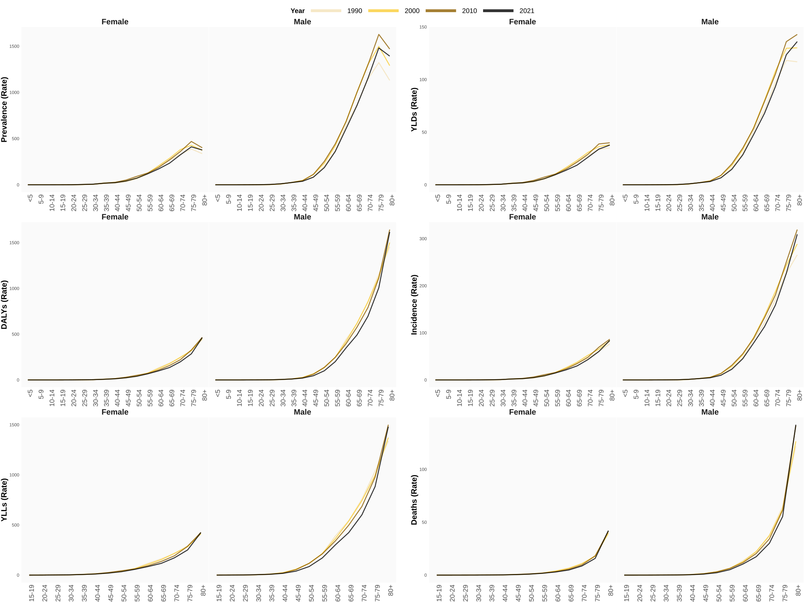

```{css}
/*| echo: false */
.body-justified p {
  text-align: justify
}
```

```{r setup}
#| include: false

# ---------------------------------------------------------------------------
# Set-up, data loading and helper functions
# ---------------------------------------------------------------------------

options(
  tidyverse.quiet = TRUE,
  dplyr.summarise.inform = FALSE
)

library(tidyverse)
library(scales)
library(glue)
library(geofacet)
library(ggnewscale)
library(future)
library(furrr)
library(gganimate)
library(paletteer)
library(flextable)

# All files in data/ are GBD 2021 extracts from the GHDx GBD Results Tool.
# Only bladder cancer is analysed here (filter is defensive: the data folder
# should already contain only this cause).
bladder_data <- 
  list.files("data", "rds", full.names = TRUE) %>%
  map_df(read_rds, .progress = TRUE) %>% 
  bind_rows() %>% 
  filter(cause_name == "Bladder cancer")

# Location IDs of the 50 states + District of Columbia (not a state; referred to
# as "jurisdictions" when pooled)
stateids <- 
  bladder_data %>% 
  filter(location_level == "United States of America") %>% 
  distinct(location_id) %>%
  pull(location_id)

source("scripts/functions.r")

# GBD location IDs used throughout
us_id <- 102
comp_ids <- c(us = 102, eu = 4743, hi = 64, hs = 44635)
region_labels <- c(
  "102" = "United States", 
  "4743" = "European Union", 
  "64" = "High-income", 
  "44635" = "High SDI"
)
keep_ids <- c(stateids, comp_ids)

# Age-standardized rates (metric "Rate", age_id 27) for U.S., states and comparators
asr <- 
  bladder_data %>% 
  filter(
    metric_id == 3, 
    age_id == 27, 
    location_id %in% keep_ids
  )

measure_label <- c(
  Incidence = "incidence", Prevalence = "prevalence", Deaths = "mortality",
  YLDs = "YLDs", YLLs = "YLLs", DALYs = "DALYs"
)
```

```{r helpers}
#| include: false

# ---------------------------------------------------------------------------
# Helper functions (these supersede ratio_calc()/diff_calc() in functions.r,
# which were called with swapped/transformed arguments in the first version)
# ---------------------------------------------------------------------------

# Number formatting: one decimal everywhere unless stated otherwise
fmt_num <- function(x, d = 1) scales::number(x, accuracy = 10^-d, big.mark = ",")
fmt_signed <- function(x, d = 1) {
  scales::number(x, accuracy = 10^-d, style_positive = "plus", style_negative = "minus")
}
# estimate [lower, upper]
fmt_ui  <- function(est, lo, hi, d = 1) {
  paste0(fmt_num(est, d), " [", fmt_num(lo, d), ", ", fmt_num(hi, d), "]")
}
# signed percent change with approximate UI: +x% [+l%, +u%]  (always lower, then upper)
fmt_pct <- function(est, lo, hi, d = 1) {
  paste0(fmt_signed(est, d), "% [", fmt_signed(lo, d), "%, ", fmt_signed(hi, d), "%]")
}

# Return exactly one row or fail loudly (avoids silent index-based mistakes)
pick <- function(data, ...) {
  out <- dplyr::filter(data, ...)
  if (nrow(out) != 1) stop("pick(): expected 1 row, got ", nrow(out), call. = FALSE)
  out
}

# Ratio of two estimates with approximate 95% UI, computed on the log scale.
# SE(log estimate) is back-calculated from the published UI bounds assuming the
# UI is symmetric on the log scale; the two estimates are assumed independent.
# Arguments are (estimate, LOWER, UPPER) for each quantity, in that order.
log_ratio_ui <- function(est1, lo1, hi1, est2, lo2, hi2, level = 0.95) {
  z <- qnorm(1 - (1 - level) / 2)
  se1 <- (log(hi1) - log(lo1)) / (2 * z)
  se2 <- (log(hi2) - log(lo2)) / (2 * z)
  se  <- sqrt(se1^2 + se2^2)
  lr  <- log(est1) - log(est2)
  tibble(
    ratio = est1 / est2,
    ratio_lower = exp(lr - z * se),
    ratio_upper = exp(lr + z * se)
  )
}

# Percent change of age-standardized rates between two years, for every
# measure x location x sex in `data`; percent change = 100 * (rate_y1 / rate_y0 - 1)
pct_change <- function(data, y0, y1) {
  wide <- 
    data %>% 
    filter(year %in% c(y0, y1)) %>% 
    mutate(period = if_else(year == y0, "start", "end")) %>% 
    select(
      measure_id, measure_name, location_id, location_name, stateabb,
      sex_id, sex_name, cause_id, cause_name, period, val, lower, upper
    ) %>% 
    pivot_wider(
      names_from = period, 
      values_from = c(val, lower, upper), 
      names_glue = "{.value}_{period}"
    )
  
  ui <- log_ratio_ui(
    wide$val_end, wide$lower_end, wide$upper_end,
    wide$val_start, wide$lower_start, wide$upper_start
  )
  
  bind_cols(wide, ui) %>% 
    mutate(
      pct = (ratio - 1) * 100,
      pct_lower = (ratio_lower - 1) * 100,
      pct_upper = (ratio_upper - 1) * 100,
      y0 = y0, 
      y1 = y1
    )
}
```

```{r data-subsets}
#| include: false

# Percent-change tables (all locations, all sexes, all measures)
chg90 <- pct_change(asr, 1990, 2021)   # primary contrast (all six measures exist)
chg10 <- pct_change(asr, 2010, 2021)   # secondary contrast
chg80 <- pct_change(                   # deaths and YLLs only (series start in 1980)
  asr %>% filter(measure_name %in% c("Deaths", "YLLs")), 1980, 2021
)

# Value lookups ---------------------------------------------------------------
val_ui <- function(loc, measure, sex = 3, yr = 2021, d = 1) {
  r <- pick(asr, location_id == loc, measure_name == measure, sex_id == sex, year == yr)
  fmt_ui(r$val, r$lower, r$upper, d)
}
chg_ui <- function(tbl, loc, measure, sex = 3) {
  r <- pick(tbl, location_id == loc, measure_name == measure, sex_id == sex)
  fmt_pct(r$pct, r$pct_lower, r$pct_upper)
}
# one labelled string per region, always in the order US, EU, High-income, High SDI
chg_line <- function(tbl, measure, sex = 3) {
  paste0(
    unname(region_labels), " ", 
    map_chr(comp_ids, \(i) chg_ui(tbl, i, measure, sex)),
    collapse = "; "
  )
}
```

```{r figure-geofacet}
#| output: false
#| results: false

# Geofaceted state plots (cached: skipped if the SVG already exists)

geofac_data <- 
  bladder_data %>% 
  filter(location_id %in% c(stateids, us_id)) %>% 
  group_by(measure_name, cause_name, metric_name) %>% 
  nest() %>% 
  ungroup()

pmap(geofac_data, geofacet_state_plot, .progress = TRUE)
```

```{r figure-us-performance}
#| output: false
#| results: false

# U.S. versus comparator regions: line plot (cached)

us_performance_data <- 
  bladder_data %>% 
  filter(
    location_id %in% comp_ids,
    sex_id == 3
  ) %>% 
  mutate(
    sex_id = NULL,
    sex_name = NULL,
    stateabb = NULL,
    location_level = NULL,
    country_group = if_else(
      location_id == us_id, 
      "United States of America",
      "European Union/High-income/High SDI"
    )
  ) %>% 
  group_by(cause_name, metric_name) %>% 
  nest() %>% 
  ungroup() %>% 
  mutate(
    data = 
      map(data, \(x) {
        
        if (27 %in% x$age_id) {
          data <- x %>% filter(age_id == 27)
          attr(data, "ageattr") <- "Age-standardized"
        } else {
          data <- x %>% filter(age_id == 22)
          attr(data, "ageattr") <- "All Ages"
        }
        
        return(data)
      }, .progress = TRUE)
  )

pmap(us_performance_data, us_performance_plt, .progress = TRUE)
```

```{r figure-bump}
#| output: false
#| results: false

# Bump plot of state ranks (cached)

states <- 
  bladder_data %>% 
  filter(!is.na(stateabb)) %>% 
  distinct(location_id, location_name, stateabb)

bumpyears <- c(1990, 2000, 2010, 2021)

bump_data <- 
  bladder_data %>% 
  group_by(cause_name, metric_name) %>% 
  nest() %>% 
  ungroup() %>% 
  mutate(
    data = map(
      data, 
      \(x) {
        
        cdata <- 
          x %>% 
          select(-c(upper, lower)) %>% 
          filter(
            year %in% bumpyears,
            location_id %in% c(comp_ids, stateids),
            sex_id == 3,
            age_id %in% c(22, 27)
          )
        
        agedata <- 
          cdata %>% 
          group_by(location_id, .add = TRUE) %>% 
          count(age_id) %>% 
          filter(age_id %in% c(22, 27)) %>%
          arrange(age_id, n) %>%
          group_by(age_id) %>% 
          summarise(sum = sum(n))
        
        if (27 %in% agedata$age_id) {
          cdata <- cdata %>% filter(age_id == 27)
          ageattr <- "Age-standardized"
        } else {
          cdata <- cdata %>% filter(age_id == 22)
          ageattr <- "All Ages"
        }
        
        cdata <- 
          cdata %>% 
          group_by(measure_name, year) %>% 
          arrange(val) %>% 
          mutate(rank = row_number()) %>% 
          arrange(measure_id, year, rank) %>% 
          mutate(order = row_number()) %>% 
          ungroup() %>% 
          mutate(
            color = if_else(
              location_id == us_id |
                (
                  year == max(.$year) & 
                    !is.na(stateabb) & 
                    !(order %>% between(6, 50))
                ), 
              "yes", "no"),
            stateabb = if_else(is.na(stateabb), location_name, stateabb), 
            stateabb = if_else(stateabb == "United States of America", "USA", stateabb),
            stateabb = if_else(stateabb == "European Union", "EU", stateabb)
          ) %>% 
          group_by(location_name, measure_name)
        
        attr(cdata, "ageattr") <- ageattr
        
        return(cdata)
        
      }, .progress = TRUE
    )
  )

pmap(bump_data, bumpplot, .progress = TRUE)
```

```{r figure-pyramid-data}
#| output: false
#| results: false

# Population pyramids: data preparation

pyramid_data <- 
  bladder_data %>% 
  filter(
    age_id %in% c(1, 6:21),
    sex_id != 3
  ) %>% 
  select(-location_level) %>% 
  arrange(age_id) %>% 
  mutate(age_name = fct_inorder(age_name)) %>% 
  group_by(measure_name, location_name) %>% 
  nest() %>% 
  filter(
    !(location_name %in% 
        c("Middle SDI", "G20", "Low SDI", "Global", "High-middle SDI", "Low-middle SDI")
      )
  )
```

```{r figure-pyramid-2021}
#| output: false
#| results: false

# Population pyramids for 2021 (cached)

patch_plots <- list()

pmap(
  pyramid_data, 
  \(data, measure_name, location_name) {
    
    pyramid_filename <- 
      paste0(
        c("fig_C", location_name, "Bladder cancer", measure_name, "Rate.svg"), 
        collapse = "_"
      )
    
    if (file.exists(paste0("output/figures/Population pyramid - 2021/", pyramid_filename))) {
      return()
    }
    
    plot <- pyramid_plot(data = data, measure_name = measure_name)
    
    ggsave(
      plot = plot,
      device = "svg",
      path = "output/figures/Population pyramid - 2021/",
      filename = pyramid_filename,
      width = 25,
      height = 25,
      units = "cm",
      dpi = 600
    )
    
    if (str_detect(pyramid_filename, "United")) {
      patch_plots[[measure_name]] <<- plot
    }
  },
  .progress = TRUE
)

if (!is_empty(patch_plots)) {
  
  library(patchwork)
  
  patch_plot <- wrap_plots(patch_plots, ncol = 3, nrow = 2)
  
  ggsave(
    plot = patch_plot,
    filename = "US_combined_pyramid.svg", 
    path = "output/figures/",
    device = "svg",
    width = 30, 
    height = 15 
  )
}
```

```{r figure-pyramid-animated}
#| output: false
#| results: false

# Animated population pyramids, 1980-2021 (cached)

years <- bladder_data %>% distinct(year) %>% pull()

plan(multisession, workers = 6)

future_pmap(
  pyramid_data,
  \(data, measure_name, location_name) {
    
    file_name <-
      paste0(c(location_name, "Bladder cancer", measure_name, "Rate"), collapse = "_") %>% 
      paste0("output/figures/Population pyramid - animated/fig_E_", ., ".gif")
    
    if (file.exists(file_name)) {return(NA)}
    
    library(gganimate)
    
    plot <- pyramid_plot(data = data, measure_name = measure_name, year = years)
    
    iserror <- 
      tryCatch(
        {ggplot_build(plot); FALSE},
        error = function(e) TRUE
      )
    
    if (iserror) {
      message("Plot could not be built, skipping: ", file_name)
      return(NA)
    }
    
    plot <-
      plot +
      transition_time(year) +
      labs(title = 'Year: {as.integer(frame_time)}') 
    
    anim_save(
      filename = file_name,
      animation = plot,  
      device = "png",
      width = 25,
      height = 25, 
      units = "cm", 
      res = 300
    ) 
  }, 
  .progress = TRUE
)

plan(sequential)
```

```{r figure-age-by-period}
#| output: false
#| results: false

# Age-specific rates in selected years ("age-by-period" display; no APC model is fitted)

apc_data <- 
  bladder_data %>% 
  filter(
    year %in% c(1990, 2000, 2010, 2021),
    age_id %in% c(1, 6:21),
    location_id %in% c(stateids, us_id),
    sex_id != 3,
    metric_id == 3
  ) %>% 
  arrange(age_id, year) %>% 
  mutate(age_name = fct_inorder(age_name)) %>% 
  group_by(location_name, measure_name) %>% 
  nest()

patch_plots <- list()

map(
  list(apc_plot1, apc_plot2),
  \(x) pmap(apc_data, x),
  .progress = TRUE
)

if (!is_empty(patch_plots)) {
  
  library(patchwork)
  
  patch_plot <- 
    wrap_plots(
      patch_plots,
      design = layout_maker(25),
      guides = "collect"
    ) &
    theme(
      legend.position = "top",
      legend.text = element_text(size = 30),
      legend.key.width = unit(6, "cm"), 
      legend.key.height = unit(3, "cm"),
      legend.title = element_text(size = 30, face = "bold")
    ) & 
    guides(color = guide_legend(override.aes = list(linewidth = 6)))
  
  ggsave(
    plot = patch_plot,
    filename = "US_combined_apc.svg", 
    path = "output/figures/",
    device = "svg",
    width = 50, 
    height = 37.5,
    limitsize = FALSE
  )
}
```

```{r key-values}
#| include: false

# ---------------------------------------------------------------------------
# All numbers quoted in the text are generated here (no hard-coded values and
# no positional indexing into filtered lists).
# ---------------------------------------------------------------------------

# --- U.S. 2021 rates (per 100,000) -------------------------------------------
inc_b <- val_ui(us_id, "Incidence", 3); inc_m <- val_ui(us_id, "Incidence", 1); inc_f <- val_ui(us_id, "Incidence", 2)
mor_b <- val_ui(us_id, "Deaths", 3);    mor_m <- val_ui(us_id, "Deaths", 1);    mor_f <- val_ui(us_id, "Deaths", 2)
daly_b <- val_ui(us_id, "DALYs", 3)

# --- U.S. percent change (approximate 95% UI) ------------------------------
chg_inc_us90 <- chg_ui(chg90, us_id, "Incidence")
chg_mor_us90 <- chg_ui(chg90, us_id, "Deaths")
chg_daly_us90 <- chg_ui(chg90, us_id, "DALYs")
chg_inc_us10 <- chg_ui(chg10, us_id, "Incidence")
chg_mor_us10 <- chg_ui(chg10, us_id, "Deaths")

# --- Peaks of the U.S. series ---------------------------------------------------
peak_of <- function(measure) {
  r <- 
    asr %>% 
    filter(location_id == us_id, sex_id == 3, measure_name == measure) %>% 
    slice_max(val, n = 1, with_ties = FALSE)
  list(year = r$year, ui = fmt_ui(r$val, r$lower, r$upper))
}
peak_inc <- peak_of("Incidence")
peak_prev <- peak_of("Prevalence")

# --- In how many years was the U.S. point estimate above each comparator? --------
n_years_above <- function(measure, comp) {
  d <- 
    asr %>% 
    filter(sex_id == 3, measure_name == measure, location_id %in% c(us_id, comp)) %>% 
    select(location_id, year, val) %>% 
    pivot_wider(names_from = location_id, values_from = val)
  c(
    above = sum(d[[as.character(us_id)]] > d[[as.character(comp)]], na.rm = TRUE), 
    n = nrow(d)
  )
}
above_txt <- function(measure) {
  ids <- comp_ids[-1]
  items <- map2_chr(ids, unname(region_labels[as.character(ids)]), \(i, lab) {
    x <- n_years_above(measure, i)
    paste0(lab, ", ", x[["above"]], " of ", x[["n"]], " years")
  })
  paste(items, collapse = "; ")
}

# --- Sex- and age-specific patterns in the U.S., 2021 -------------------------------
age_sex_us <- 
  bladder_data %>% 
  filter(
    location_id == us_id, year == 2021, metric_id == 3,
    age_id %in% c(1, 6:21), sex_id %in% 1:2
  )

age_sex_wide <- 
  age_sex_us %>% 
  select(measure_name, age_id, sex_name, val) %>% 
  pivot_wider(names_from = sex_name, values_from = val)

n_cmp <- nrow(age_sex_wide)
n_male_higher <- sum(age_sex_wide$Male > age_sex_wide$Female, na.rm = TRUE)

age_peak_txt <- 
  age_sex_us %>% 
  group_by(measure_name, sex_name) %>% 
  slice_max(val, n = 1, with_ties = FALSE) %>% 
  ungroup() %>% 
  mutate(
    item = paste0(
      if_else(sex_name == "Male", "men", "women"), " (", age_name, "): ", 
      fmt_ui(val, lower, upper)
    )
  ) %>% 
  group_by(measure_name) %>% 
  summarise(txt = paste0(measure_label[first(measure_name)], ", ", paste(item, collapse = "; "))) %>% 
  pull(txt) %>% 
  paste(collapse = ". ")

# --- Sex ratios, 2021 (point estimate, approximate UI assuming independence) -------------
discrep_data <- 
  asr %>% 
  filter(sex_id %in% c(1, 2), year == 2021, location_id %in% c(stateids, us_id)) %>% 
  mutate(abb = if_else(location_id == us_id, "USA", stateabb)) %>% 
  select(measure_name, jurisdiction = location_name, location_name = abb, sex_name, val, lower, upper) %>% 
  pivot_wider(names_from = sex_name, values_from = c(val, lower, upper))

discrep_data <- 
  bind_cols(
    discrep_data,
    log_ratio_ui(
      discrep_data$val_Male, discrep_data$lower_Male, discrep_data$upper_Male,
      discrep_data$val_Female, discrep_data$lower_Female, discrep_data$upper_Female
    )
  ) %>% 
  mutate(readable_name = unname(measure_label[measure_name]))

rr_summary <- function(measure) {
  d <- discrep_data %>% filter(measure_name == measure, location_name != "USA")
  lo <- slice_min(d, ratio, n = 1, with_ties = FALSE)
  hi <- slice_max(d, ratio, n = 1, with_ties = FALSE)
  list(
    lo = lo, hi = hi,
    overlap = lo$ratio_upper >= hi$ratio_lower,
    lo_txt = paste0(lo$jurisdiction, ", ", fmt_ui(lo$ratio, lo$ratio_lower, lo$ratio_upper)),
    hi_txt = paste0(hi$jurisdiction, ", ", fmt_ui(hi$ratio, hi$ratio_lower, hi$ratio_upper))
  )
}
rr_inc <- rr_summary("Incidence")
rr_mor <- rr_summary("Deaths")
us_rr_inc <- discrep_data %>% pick(measure_name == "Incidence", location_name == "USA")
us_rr_inc_txt <- fmt_ui(us_rr_inc$ratio, us_rr_inc$ratio_lower, us_rr_inc$ratio_upper)
overlap_phrase <- function(x) {
  if (x$overlap) "overlapped" else "did not overlap"
}

# --- State rankings (point estimates; both sexes) -----------------------------------
state_rank <- function(measure, yr, n = 5, highest = TRUE) {
  d <- asr %>% filter(location_id %in% stateids, sex_id == 3, measure_name == measure, year == yr)
  d <- if (highest) slice_max(d, val, n = n, with_ties = FALSE) else slice_min(d, val, n = n, with_ties = FALSE)
  knitr::combine_words(paste0(d$location_name, " (", fmt_num(d$val), ")"))
}
state_change_rank <- function(measure, n = 5, largest_decline = TRUE) {
  d <- chg90 %>% filter(location_id %in% stateids, sex_id == 3, measure_name == measure)
  d <- if (largest_decline) slice_min(d, pct, n = n, with_ties = FALSE) else slice_max(d, pct, n = n, with_ties = FALSE)
  knitr::combine_words(paste0(d$location_name, " (", fmt_signed(d$pct), "%)"))
}
n_ui_cat <- function(measure) {
  d <- chg90 %>% filter(location_id %in% stateids, sex_id == 3, measure_name == measure)
  c(
    below = sum(d$pct_upper < 0, na.rm = TRUE), 
    above = sum(d$pct_lower > 0, na.rm = TRUE),
    spans = sum(d$pct_lower <= 0 & d$pct_upper >= 0, na.rm = TRUE), 
    n = nrow(d)
  )
}
cat_inc <- n_ui_cat("Incidence")
cat_mor <- n_ui_cat("Deaths")

# --- How often do the published UIs of two jurisdictions overlap? (2021, both sexes) ---
pair_overlap <- function(measure, yr = 2021) {
  d <- asr %>% filter(location_id %in% stateids, sex_id == 3, measure_name == measure, year == yr)
  n <- nrow(d)
  ov <- outer(seq_len(n), seq_len(n), Vectorize(\(i, j) d$lower[i] <= d$upper[j] & d$lower[j] <= d$upper[i]))
  mean(ov[upper.tri(ov)])
}
ov_inc <- scales::percent(pair_overlap("Incidence"), accuracy = 1)
ov_mor <- scales::percent(pair_overlap("Deaths"), accuracy = 1)

# --- Absolute counts (only if the 'Number' metric is part of the extracted data) ---------
has_counts <- any(bladder_data$metric_id == 1, na.rm = TRUE)

if (has_counts) {
  counts <- 
    bladder_data %>% 
    filter(
      metric_id == 1, age_id == 22, sex_id == 3, location_id == us_id, 
      year %in% c(1990, 2021), measure_name %in% c("Incidence", "Deaths")
    )
  cnt <- function(m, y) {
    r <- pick(counts, measure_name == m, year == y)
    fmt_ui(r$val, r$lower, r$upper, 0)
  }
  counts_sentence <- glue(
    "The estimated number of incident cases (all ages, both sexes) was {cnt('Incidence', 1990)} in 1990 and {cnt('Incidence', 2021)} in 2021, and the estimated number of deaths was {cnt('Deaths', 1990)} in 1990 and {cnt('Deaths', 2021)} in 2021."
  )
} else {
  counts_sentence <- "Absolute case and death counts were not part of the extracted dataset; we therefore cannot report changes in the number of cases."
}

# --- Abbreviation strings for figure notes -----------------------------------------
state_abbs <- 
  states %>%
  arrange(location_name) %>% 
  glue_data("{location_name}: {stateabb}") %>% 
  paste0(collapse = "; ")
country_abbs <- "EU: European Union; SDI: Socio-Demographic Index"
measure_abbs <- "DALYs: disability-adjusted life years; YLDs: years lived with disability; YLLs: years of life lost"

# --- Reproducibility metadata ------------------------------------------------------
commit_id <- tryCatch(
  system("git rev-parse --short HEAD", intern = TRUE, ignore.stderr = TRUE)[1],
  error = function(e) NA_character_,
  warning = function(w) NA_character_
)
commit_txt <- if (is.na(commit_id)) "[commit hash to be inserted at resubmission]" else commit_id
zenodo_doi <- "[Zenodo DOI to be inserted upon archiving]"
```

```{r export-tables}
#| include: false

# ---------------------------------------------------------------------------
# Numeric tables written to output/tables (Supporting Files 1 and 2)
# ---------------------------------------------------------------------------

dir.create("output/tables", showWarnings = FALSE, recursive = TRUE)

# Supporting File 1: percent change for every location, sex and measure
bind_rows(chg90, chg10, chg80) %>% 
  mutate(contrast = paste0(y0, "-", y1)) %>% 
  select(
    contrast, measure_name, location_name, stateabb, sex_name,
    rate_start = val_start, rate_start_lower = lower_start, rate_start_upper = upper_start,
    rate_end = val_end, rate_end_lower = lower_end, rate_end_upper = upper_end,
    pct_change = pct, pct_change_lower = pct_lower, pct_change_upper = pct_upper
  ) %>% 
  mutate(across(where(is.numeric), \(x) round(x, 3))) %>% 
  write_csv("output/tables/percent_change_all_locations.csv")

# Supporting File 2: male:female rate ratios in 2021
discrep_data %>% 
  select(
    measure_name, jurisdiction, abbreviation = location_name,
    rate_male = val_Male, rate_male_lower = lower_Male, rate_male_upper = upper_Male,
    rate_female = val_Female, rate_female_lower = lower_Female, rate_female_upper = upper_Female,
    ratio, ratio_lower, ratio_upper
  ) %>% 
  mutate(across(where(is.numeric), \(x) round(x, 3))) %>% 
  write_csv("output/tables/sex_ratios_2021.csv")
```

```{r supporting-graphical-table}
#| output: false
#| results: false

# Supporting File 3: graphical table of percent change, 1990-2021, by sex
# (bars show percent change with approximate 95% UI; fpmaker()/ggmaker() are in scripts/functions.r)

old_file <- "output/tables/Percent change since 1980 in Bladder cancer measures.docx"
new_file <- "output/tables/Percent change 1990-2021 in Bladder cancer measures.docx"

change_data <-
  chg90 %>%
  filter(sex_id != 3) %>%
  mutate(.keep = "none",
    measure_id, measure_name, location_id, location_name, sex_id, sex_name,
    cause_id, cause_name, stateabb,
    diffval = pct / 100, 
    diffupper = pct_upper / 100, 
    difflower = pct_lower / 100
  ) %>%
  mutate(
    color = case_when(
      sign(diffupper) != sign(difflower) ~ "neutral",
      diffupper > 0 ~ "positive",
      diffupper < 0 ~ "negative"
    )
  ) %>%
  group_by(cause_name, measure_name) %>%
  mutate(
    upperlim = max(diffupper),
    lowerlim = min(difflower)
  ) %>%
  ungroup()

if (!file.exists(new_file)) {
  
  # fpmaker() writes its own file name; remove the stale (mis-labelled) file first
  unlink(old_file)
  
  table_ggplot_data <-
    change_data %>%
    mutate(
      plot = pmap(
        list(diffval, diffupper, difflower, upperlim, lowerlim, color),
        ggmaker,
        .progress = TRUE
      )
    ) %>% 
    arrange(desc(is.na(stateabb)), location_name) %>%
    mutate(location_name = if_else(is.na(stateabb), location_name, stateabb)) %>%
    select(-c(diffval:lowerlim), -contains("_id"), -stateabb) %>%
    rename_with(\(x) str_remove(x, "_name")) %>%
    pivot_wider(
      names_sep = "_",
      id_cols = c(location, cause),
      names_from = c(measure, sex),
      values_from = plot
    ) %>%
    group_by(cause) %>%
    nest()
  
  invisible(
    table_ggplot_data %>%
      mutate(new = map2(data, cause, \(x, y) fpmaker(x, y), .progress = TRUE))
  )
  
  if (file.exists(old_file)) file.rename(old_file, new_file)
  if (!file.exists(new_file)) warning("fpmaker() did not create the expected file: ", new_file)
}
```

::: {.content-visible when-format="docx"}
**Authors contact**

```{r author-contacts}
#| results: asis

authors <- rmarkdown::metadata$author

author_data <- 
  authors |> 
  map(\(a) {
    tibble(
      name          = a$name,
      corresponding = a$corresponding %||% NA,
      email         = a$email %||% NA,
      orcid         = a$orcid %||% NA,
      degrees       = a$degrees %||% NA,
      roles         = list(a$roles),
      affiliations  = list(map_chr(a$affiliations, "ref"))
    )
  }) |> 
  list_rbind() |>       
  unnest(c(roles, affiliations))

contacts_data <- 
  author_data %>% 
  distinct(name, email, orcid)

cat(
  glue_data(
    contacts_data, 
    "{name}\n\n   + Email <{email}>\n\n  +  ORCID [{orcid}](https://orcid.org/{orcid})\n\n\n", 
    .na = ""
  )
)
```
:::



:::: body-justified
# Abstract

**Background:** Bladder cancer (BC) is a common malignancy with substantial morbidity, mortality and health-care cost, but comparable, state-level estimates of its burden and of sex differences in the U.S. are limited.\
**Aim:** To describe Global Burden of Disease (GBD) 2021 estimates of BC incidence, prevalence, mortality, disability-adjusted life years (DALYs), years lived with disability (YLDs) and years of life lost (YLLs) in the U.S. and its states, their change over time, and male-to-female differences. This is a descriptive analysis of modelled estimates; it does not test causes or policy effects.\
**Methods:** We extracted age-standardized rates (ASRs; per 100,000) with 95% uncertainty intervals (UIs) from GBD 2021 for the U.S., the 50 states and the District of Columbia, and for the European Union, high-income and high-SDI aggregates (which include the U.S.). Series cover 1990–2021 (deaths and YLLs also 1980–2021). Percent changes (1990–2021) and male:female rate ratios (2021) were derived from published point estimates and UIs under approximating assumptions.The final version and code of this study are also available from [www.bladder-cancer.ir](https://bladder-cancer.ir/). \
**Results:** In 2021, the U.S. ASR of BC incidence was `r inc_b` per 100,000 (men `r inc_m`; women `r inc_f`) and the ASR of mortality was `r mor_b` per 100,000 (men `r mor_m`; women `r mor_f`); DALYs were `r daly_b` per 100,000. Compared with 1990, the 2021 ASR changed by `r chg_inc_us90` for incidence, `r chg_mor_us90` for mortality and `r chg_daly_us90` for DALYs (percent change [approximate 95% UI]). State-level male:female incidence rate ratios in 2021 ranged from `r fmt_num(rr_inc$lo$ratio)` to `r fmt_num(rr_inc$hi$ratio)` (point estimates); the approximate UIs of the lowest and highest jurisdictions `r overlap_phrase(rr_inc)`, and the published UIs of the 2021 incidence ASR overlapped for `r ov_inc` of all pairs of jurisdictions, so rankings should be interpreted cautiously.\
**Conclusion:** GBD 2021 estimates show a male excess in BC burden and variation across U.S. states and over time. Because these are modelled, descriptive estimates, they do not identify the causes of the differences; hypotheses about exposures, health-care access and policy require study designs that measure them.

**Keywords:** *`r rmarkdown::metadata$keywords %>% paste0(collapse = "; ")`*



# Introduction

Bladder cancer (BC) is among the most commonly diagnosed cancers in the U.S. The American Cancer Society projects approximately 84,530 new cases and 17,870 deaths from BC in 2026 [@acs2026factsfigures], and BC is the tenth leading cause of cancer death [@acs2026factsfigures; @seer_bladder_statfacts]. It is considerably more common in men than in women [@RN22]. Globally, the absolute burden of BC is increasing despite declining age-standardized rates [@RN3].

Beyond its epidemiological impact, BC imposes a substantial economic burden. Its management commonly requires lifelong surveillance and repeated therapeutic interventions, and BC has been described as the most costly cancer to treat on a per-patient lifetime basis [@RN4; @RN5; @RN6]. In addition to direct healthcare expenditures, BC affects patients’ quality of life and the emotional, social, and practical well-being of caregivers and families [@RN7].

Substantial geographic heterogeneity in BC incidence and outcomes has been documented across the U.S. [@RN14; @RN15; @RN16; @RN17]. For instance, Maine reported an age-standardized incidence rate of 26.7 per 100,000 during 2017–2021, nearly double that observed in Hawaii (13.4) [@RN18]. Registry-based reports describe the highest incidence in northeastern states [@RN16] and disproportionately high mortality in Southern states [@RN19]; proposed explanations include differences in environmental exposures, socioeconomic conditions, age and racial composition, rurality, and access to care [@RN20].

Despite these observations, most prior BC research has focused on national trends or single-institution cohorts, and contemporary, age-standardized, state-level comparisons remain limited. Although the GBD project produces estimates of disability-adjusted life years (DALYs), years lived with disability (YLDs), and years of life lost (YLLs) for BC, these measures have rarely been used in disease-specific descriptions of the U.S. National studies indicate that men have approximately three to four times higher BC incidence than women [@RN22], whereas women often present with more advanced disease and have poorer survival [@RN23]; the geographic distribution of sex differences has not, to our knowledge, been described systematically at the state level.

We therefore used GBD 2021 estimates, which provide internally consistent, modelled estimates of key BC burden measures for all U.S. states, to describe (i) the estimated burden of BC in the U.S. and its states over time, benchmarked against comparator regions; (ii) its age and sex patterns; and (iii) male-to-female differences across states. The analysis is descriptive. It does not evaluate health policies, exposures, or their effects.

# Methodology

## Study design and data sources {#sec-study-design}

This is a descriptive, secondary analysis of publicly available GBD 2021 estimates. GBD produces modelled estimates for diseases and injuries by age, sex, location and year, which allows standardized comparison across U.S. states and over time [@ferrari2024; @naghavi2024]. Estimates were downloaded from the [Global Health Data Exchange (GHDx) GBD Results Tool](https://ghdx.healthdata.org/). The download provides, for each combination of measure, location, sex, age group and year, a point estimate and the lower and upper bounds of the 95% uncertainty interval (UI); posterior draws are not part of this public download (see @sec-app-uncert).

We extracted incidence, prevalence, mortality (deaths), YLLs, YLDs and DALYs for males, females and both sexes, for all age groups, five-year age groups and the age-standardized rate, for the U.S., the 50 states and the District of Columbia (DC; not a state, hence “jurisdictions” when pooled), and for three comparator regions: the European Union, the high-income super-region and the high-SDI quintile. Rates are expressed per 100,000 population. Years covered differ by measure: mortality and YLLs are available for 1980–2021, whereas the non-fatal measures (incidence, prevalence, YLDs) and therefore DALYs start in 1990. All quantified changes use 1990–2021 (the first year for which all six measures exist and the conventional GBD baseline) as the primary contrast, and 2010–2021 as a secondary contrast; the 1980–2021 change for deaths and YLLs is provided in [Supporting File 1](#sup-percentchange). Figures show all available years.

GBD 2021 was used because the analysis pipeline and all state-level extracts were built on this release. GBD 2023 results, including cancer estimates, have since been published [@gbd2023cancer]; this is discussed as a limitation (@sec-strengths-limits). Given the value codes and data structure remains the same in GBD 2023 data, this study will be easily reproducible by replacing the data. Cancer estimation in GBD is anchored on mortality: incidence is derived from mortality using mortality-to-incidence ratios, and prevalence and YLDs are derived from incidence and survival [@kocarnik2022cancer]. The six measures are therefore not independent sources of information.

## Definitions

Bladder cancer

:   As defined in GBD 2021 using the International Classification of Diseases (ICD): ICD-10 codes C67–C67.9 and ICD-9 codes 188–188.9, V10.51, V16.52 and V76.3. These codes are reproduced from the GBD 2021 cause list and cause-mapping appendices [@naghavi2024; @ferrari2024] and were not modified by the authors.

Disability-adjusted life years (DALYs)

:   A summary measure of population health that combines YLLs and YLDs.

Years of life lost (YLLs)

:   The fatal component of DALYs: years lost due to death occurring before the reference life expectancy.

Years lived with disability (YLDs)

:   The non-fatal component of DALYs: time lived in health states less than full health, weighted by severity.

Socio-Demographic Index (SDI)

:   A composite measure developed within the GBD framework reflecting income per capita, average educational attainment among people aged 15 years or older, and fertility among those younger than 25 years [@instituteforhealthmetricsandevaluation2024]. It ranges from 0 to 1 and is used to classify locations into five quintiles (low to high SDI).

Comparator regions

:   The European Union, the high-income super-region and the high-SDI quintile, used as reference points for the U.S. The U.S. is itself a constituent of the high-income and high-SDI aggregates and contributes a substantial share of their population; contrasts between the U.S. and these aggregates are therefore not independent country-to-country comparisons and are expected to be attenuated. The European Union does not contain the U.S.

Age-standardized rate (ASR)

:   A rate adjusted to a common age structure so that populations with different age distributions can be compared. By construction, an ASR is not affected by changes in the age structure of the population. ASRs were obtained directly from the GBD Results Tool (they were not recalculated by the authors). GBD uses direct standardization to the GBD world standard population:

$$
\mathrm{ASR} = \frac{\sum_{i=1}^{A} a_i\, w_i}{\sum_{i=1}^{A} w_i} \times 100{,}000
$$

where $a_i$ is the age-specific rate (events per person-year) in age group $i$, $w_i$ is the corresponding standard-population weight, and $A$ is the number of age groups.

## Statistical analysis

### Summary measures

All statements about trends refer either to the plotted series or to the following fixed summary measures; no trend model (e.g., Joinpoint regression, annual percent change, or an age–period–cohort model) was fitted, and no test of differing slopes between the U.S. and comparators was performed.

1. *Percent change* in the ASR between two years, $100\times(a_{\text{end}}/a_{\text{start}}-1)$, for 1990–2021 and 2010–2021 (and 1980–2021 for deaths and YLLs), for the U.S., each jurisdiction and each comparator region, by sex and measure.
2. *Male:female rate ratio* of ASRs in 2021 for each jurisdiction and measure.
3. *Rank* of jurisdictions by point estimate of the 2021 ASR (both sexes).

The 95% UIs reported for GBD estimates are Bayesian uncertainty intervals (2.5th and 97.5th percentiles of 1,000 posterior draws) that reflect data sparsity, measurement error and model specification [@naghavi2024]. They are not frequentist confidence intervals. We therefore do not use the word “significant”, and describe whether an approximate UI includes zero only as a description of that interval.

### Approximate uncertainty intervals for derived quantities {#sec-app-uncert}

Percent changes and rate ratios are derived quantities for which the public GBD download does not provide UIs. The posterior-draw approach, in which the quantity is computed in each draw and then summarised, is the preferred way of obtaining UIs for derived quantities in GBD [@vos2020]. Because draws were not part of our download, we approximated these UIs from the published bounds using standard methods for ratios of independent estimates [@altman2003statistics; @rothman2008modern].

For two ASRs $a_1$ and $a_2$ with published 95% UIs $[l_1,u_1]$ and $[l_2,u_2]$, the standard error of each log-rate was back-calculated from the bounds, assuming that the UI is symmetric on the log scale (this is a direct back-calculation, not a delta-method approximation):

$$
SE_{\log(a_k)} \approx \frac{\log(u_k) - \log(l_k)}{2\, z_{0.975}}, \quad k = 1, 2, \qquad z_{0.975}\approx 1.96 .
$$

The ratio $R=a_1/a_2$ (for percent change, $a_1$ is the later and $a_2$ the earlier year; percent change is $100(R-1)$; for sex differences, $a_1$ is the male and $a_2$ the female rate) has $\log R=\log a_1-\log a_2$ and

$$
SE_{\log R} = \sqrt{SE_{\log a_1}^2 + SE_{\log a_2}^2}, \qquad
\text{UI}_{95\%} = \exp\!\big(\log R \pm z_{0.975}\, SE_{\log R}\big).
$$

The point estimate is the ratio of the published point estimates, not the median of draw-wise ratios.

**Limitations of the approximation.** (i) The estimates being compared (two years, or the two sexes, of the same location) come from shared models, covariates and input data and are therefore not independent. The sign of the dependence cannot be determined from published summaries: positive correlation would make the approximate UIs too wide, negative correlation too narrow. (ii) Published UIs are often asymmetric on the log scale, and the GBD point estimate is a mean of draws rather than a median. The resulting intervals are therefore labelled *approximate*, are intended to convey the order of magnitude of uncertainty, and are not used for formal tests. In particular, we do not interpret non-overlap (or overlap) of two jurisdictions’ intervals as a test of a difference between them.

## Reporting and reproducibility

This study follows the Guidelines for Accurate and Transparent Health Estimates Reporting (GATHER) [@stevens2016gather]; the completed checklist, with manuscript locations, is provided as [Supporting File 10](#sup-gather). All numbers quoted in the Abstract and Results are generated by the analysis code from the downloaded data, rather than typed. Analyses used `r R.version.string`; package versions are listed in [Supporting File 9](#sup-software). Complete code, cleaned data (in `RDS` format) and figure files are in the study’s [GitHub repository](https://github.com/alireza5969/gbd-bladder-cancer); the submitted figures and tables were generated from commit `r commit_txt`, archived at `r zenodo_doi`.

# Results

## U.S. compared with comparator regions {#sec-compare-us}

```{r results-us-comparison}
#| include: false

mor_comp <- map_chr(comp_ids[-1], \(i) val_ui(i, "Deaths", 3))
names(mor_comp) <- unname(region_labels[as.character(comp_ids[-1])])
```

In 2021, the U.S. age-standardized incidence rate of BC was `r inc_m` per 100,000 in men and `r inc_f` in women, and the age-standardized mortality rate was `r mor_m` in men and `r mor_f` in women (point estimate [95% UI]). For both sexes combined, the 2021 mortality rate was `r mor_b` in the U.S., compared with `r mor_comp[["European Union"]]` in the European Union, `r mor_comp[["High-income"]]` in the high-income aggregate and `r mor_comp[["High SDI"]]` in the high-SDI aggregate (all per 100,000).

The U.S. ASR of incidence (both sexes) peaked in `r peak_inc$year` (`r peak_inc$ui` per 100,000) and the ASR of prevalence in `r peak_prev$year` (`r peak_prev$ui`). The U.S. point estimate of the incidence ASR exceeded that of each comparator in the following numbers of years: `r above_txt("Incidence")`. For mortality, the U.S. point estimate exceeded that of each comparator in: `r above_txt("Deaths")`. @fig-performance shows the series; @tbl-comparison gives, for each region and measure, the 1990 and 2021 rates and the percent changes, and is the source for the figures quoted below.

{#fig-performance}

*Abbreviations: `r measure_abbs`; `r country_abbs`.*

```{r}
#| label: tbl-comparison
#| tbl-cap: "Age-standardized rates (per 100,000; both sexes) and percent change, U.S. and comparator regions. Values are point estimate [95% UI]. Percent-change UIs are approximate (see Methods, @sec-app-uncert); the U.S. is part of the high-income and high-SDI aggregates."

measure_order <- c("Incidence", "Prevalence", "Deaths", "YLDs", "YLLs", "DALYs")
measure_disp <- c(Incidence = "Incidence", Prevalence = "Prevalence", Deaths = "Mortality", 
                  YLDs = "YLDs", YLLs = "YLLs", DALYs = "DALYs")

t1_a <- chg90 %>% filter(sex_id == 3, location_id %in% comp_ids)
t1_b <- chg10 %>% filter(sex_id == 3, location_id %in% comp_ids)

t1 <- 
  t1_a %>% 
  mutate(.keep = "none",
    measure_name, location_id,
    r1990 = fmt_ui(val_start, lower_start, upper_start),
    r2021 = fmt_ui(val_end, lower_end, upper_end),
    c9021 = fmt_pct(pct, pct_lower, pct_upper)
  ) %>% 
  left_join(
    t1_b %>% mutate(.keep = "none", measure_name, location_id, c1021 = fmt_pct(pct, pct_lower, pct_upper)),
    by = c("measure_name", "location_id")
  ) %>% 
  mutate(
    Measure = factor(unname(measure_disp[measure_name]), levels = unname(measure_disp[measure_order])),
    Region = unname(region_labels[as.character(location_id)]),
    ord = match(location_id, comp_ids)
  ) %>% 
  arrange(Measure, ord) %>% 
  mutate(.keep = "none",
    Measure = as.character(Measure), Region, 
    `1990` = r1990, `2021` = r2021, 
    `% change 1990–2021` = c9021, `% change 2010–2021` = c1021
  )

flextable(t1) %>% 
  merge_v(j = "Measure") %>% 
  valign(j = "Measure", valign = "top") %>% 
  fontsize(size = 8, part = "all") %>% 
  autofit() %>% 
  fit_to_width(max_width = 6.5)
```

*Abbreviations: UI, uncertainty interval; SDI, Socio-Demographic Index; YLDs, years lived with disability; YLLs, years of life lost; DALYs, disability-adjusted life years.*

For both sexes combined, the percent change in the ASR of mortality between 1990 and 2021 was, by region (percent change [approximate 95% UI]): `r chg_line(chg90, "Deaths")`. For DALYs it was: `r chg_line(chg90, "DALYs")`. For incidence it was: `r chg_line(chg90, "Incidence")`; and between 2010 and 2021: `r chg_line(chg10, "Incidence")`. Sex-specific values, and values for all other measures and for every jurisdiction, are in [Supporting File 1](#sup-percentchange) and, as a graphical table, [Supporting File 3](#sup-percentchange-graphic). Because the percent-change intervals are approximate and no trend model was fitted, we describe these as differences between years, not as tests of trend. Because the high-income and high-SDI aggregates contain the U.S., differences between the U.S. and these aggregates are attenuated by construction.

## Age and sex patterns in the U.S. {#sec-patterns}

As illustrated in @fig-pyramid, in 2021 the male rate exceeded the female rate in `r n_male_higher` of `r n_cmp` age-group–by–measure combinations. The highest 2021 age-specific rates (per 100,000) were: `r age_peak_txt`.

{#fig-pyramid}

*Abbreviations: `r measure_abbs`.*

State-level population pyramids for 2021 are provided in [Supporting File 4](#sup-pyramid2021), and animated pyramids showing change by year for each state and the U.S. in [Supporting File 5](#sup-pyramidgif). @fig-apc displays age-specific rates in 1990, 2000, 2010 and 2021 by sex. It is a descriptive age-by-period display; no age–period–cohort model was fitted. Corresponding plots for each state are in [Supporting File 6](#sup-apc).

{#fig-apc}

*Abbreviations: `r measure_abbs`.*

`r counts_sentence`

## Bladder cancer burden across U.S. states

State-specific, sex-stratified temporal trends in age-standardized *incidence* rates are displayed in @fig-geofacet; geofaceted plots for the other five measures are provided in [Supporting File 7](#sup-geofacet).

{#fig-geofacet}

*Abbreviations: `r state_abbs`.*

@tbl-states lists the 2021 age-standardized incidence and mortality rates (both sexes), the rank of each jurisdiction by point estimate (1 = highest), and the percent change since 1990. By point estimate, the highest 2021 incidence ASRs (both sexes, per 100,000) were in `r state_rank("Incidence", 2021)` and the lowest in `r state_rank("Incidence", 2021, highest = FALSE)`; the highest 2021 mortality ASRs were in `r state_rank("Deaths", 2021)` and the lowest in `r state_rank("Deaths", 2021, highest = FALSE)`. These are rankings of point estimates; the published 95% UIs of the 2021 ASR overlapped for `r ov_inc` of all pairs of jurisdictions for incidence and `r ov_mor` for mortality (@tbl-states), so the ranking itself is uncertain. Between 1990 and 2021, the largest point-estimate decreases in incidence ASR were in `r state_change_rank("Incidence")`, and the smallest decreases or largest increases in `r state_change_rank("Incidence", largest_decline = FALSE)`. The approximate UI of the 1990–2021 percent change in incidence lay entirely below zero in `r cat_inc[["below"]]` of `r cat_inc[["n"]]` jurisdictions, entirely above zero in `r cat_inc[["above"]]`, and included zero in `r cat_inc[["spans"]]`; for mortality the corresponding numbers were `r cat_mor[["below"]]`, `r cat_mor[["above"]]` and `r cat_mor[["spans"]]`. Rates by sex for all six measures are in [Supporting File 1](#sup-percentchange).

```{r}
#| label: tbl-states
#| tbl-cap: "Age-standardized incidence and mortality rates (per 100,000; both sexes), 2021, rank among the 50 states and DC by point estimate (1 = highest), and percent change 1990–2021, with 95% UI (percent-change UIs approximate)."

state_chg <- chg90 %>% filter(location_id %in% c(stateids, us_id), sex_id == 3)

state_block <- function(measure, prefix) {
  state_chg %>%
    filter(measure_name == measure) %>%
    mutate(
      val_for_rank = if_else(location_id == us_id, NA_real_, val_end),
      rank = min_rank(desc(val_for_rank))
    ) %>%
    mutate(.keep = "none",
      location_id,
      "{prefix}_rate" := fmt_ui(val_end, lower_end, upper_end),
      "{prefix}_rank" := if_else(is.na(rank), "–", as.character(rank)),
      "{prefix}_chg"  := fmt_pct(pct, pct_lower, pct_upper)
    )
}

state_table <- 
  state_chg %>% 
  filter(measure_name == "Incidence") %>% 
  select(location_id, Jurisdiction = location_name) %>% 
  left_join(state_block("Incidence", "inc"), by = "location_id") %>% 
  left_join(state_block("Deaths", "mor"), by = "location_id") %>% 
  arrange(location_id != us_id, Jurisdiction) %>% 
  select(-location_id)

flextable(state_table) %>% 
  set_header_labels(
    inc_rate = "2021 rate", inc_rank = "Rank", inc_chg = "% change 1990–2021",
    mor_rate = "2021 rate", mor_rank = "Rank", mor_chg = "% change 1990–2021"
  ) %>% 
  add_header_row(values = c("", "Incidence", "Mortality"), colwidths = c(1, 3, 3)) %>% 
  fontsize(size = 7, part = "all") %>% 
  autofit() %>% 
  fit_to_width(max_width = 6.5)
```

@fig-discrep displays male-to-female rate ratios of ASRs in 2021 for each jurisdiction and measure. Because incidence is derived from mortality and prevalence and YLDs are derived from incidence and survival in the GBD cancer models [@kocarnik2022cancer], the six ratios are strongly related by construction and are not independent evidence; we therefore describe incidence and mortality. Across the 50 states and DC, male:female incidence rate ratios ranged from `r rr_inc$lo_txt` (lowest point estimate) to `r rr_inc$hi_txt` (highest point estimate), and mortality ratios from `r rr_mor$lo_txt` to `r rr_mor$hi_txt` (ratio [approximate 95% UI]). The approximate UIs of the lowest and highest jurisdictions `r overlap_phrase(rr_inc)` for incidence and `r overlap_phrase(rr_mor)` for mortality. These UIs assume independence between the male and female estimates (@sec-app-uncert) and must not be read as a test of a difference between jurisdictions. For the U.S. overall, the 2021 male:female incidence ratio was `r us_rr_inc_txt`. All ratios are in [Supporting File 2](#sup-ratios).

{#fig-discrep}

*Abbreviations: `r state_abbs`; `r measure_abbs`.*

```{r figure-sex-ratio}
#| output: false
#| results: false

# Saves the sex-ratio figure (fig_H.svg) from the corrected ratios
invisible(gender_discrep_plot(discrep_data))
```

Bump plots comparing the U.S., all jurisdictions and the comparator regions across measures in 1990, 2000, 2010 and 2021 are in [Supporting File 8](#sup-bump).

# Discussion

## Principal findings

In this descriptive analysis of GBD 2021 estimates, the U.S. age-standardized incidence rate of BC in 2021 was `r inc_b` per 100,000 and the age-standardized mortality rate `r mor_b` per 100,000 (both sexes). The incidence ASR peaked in `r peak_inc$year`; between 2010 and 2021 it changed by `r chg_inc_us10`, and between 1990 and 2021 by `r chg_inc_us90`. The mortality ASR changed by `r chg_mor_us90` between 1990 and 2021 and by `r chg_mor_us10` between 2010 and 2021 (percent change [approximate 95% UI]). We did not fit a trend model, so these are differences between years and not statements about the statistical significance of a trend. Across jurisdictions, estimated changes since 1990 varied (@tbl-states); for `r cat_inc[["spans"]]` of `r cat_inc[["n"]]` jurisdictions the approximate UI of the incidence change included zero. All of these results are modelled estimates, and no exposure, policy or health-system variable was analysed; explanations offered below are hypotheses drawn from the literature, not findings of this study.

## Comparison with other regions

The numbers of years in which the U.S. point estimate of incidence exceeded that of each comparator are given in @sec-compare-us. The high-income and high-SDI aggregates contain the U.S., so those contrasts are attenuated by construction and are not independent country-to-country comparisons; the European Union is the only comparator that excludes the U.S. A higher estimated incidence in the U.S. may partly reflect more intensive diagnostic activity (cystoscopy, imaging, and evaluation of hematuria) and case ascertainment [@RN25; @RN26; @RN27], which raises recorded incidence without necessarily changing mortality, and/or differences in underlying risk, such as smoking history. This study cannot separate these possibilities, which are not mutually exclusive. Registry-based age-adjusted rates (for example, the SEER rate of about 18 per 100,000 for 2018–2022 [@seer_bladder_statfacts]) are not directly comparable with GBD ASRs, which use a different standard population and are modelled.

## Age

Age-standardized and age-specific rates are by design unaffected by population ageing; the rates reported here therefore cannot be attributed to population ageing. Ageing influences the number of cases: the U.S. population aged 65 years and older increased by 38.6% between 2010 and 2020 [@census2023dhc]. `r counts_sentence` The age groups with the highest age-specific rates are reported in @sec-patterns; a rise in BC burden with age is in line with prior literature [@RN3]. An earlier analysis reported that the oldest adults, especially men aged 85 years and older, had not shared in the improvements in cancer mortality seen in younger seniors [@RN32]. We did not examine whether differences between states in age-specific rates reflect true differences, and we do not interpret them.

## Sex differences

Male rates exceeded female rates in `r n_male_higher` of `r n_cmp` age-group–by–measure combinations in 2021 (@sec-patterns). The 2021 U.S. male:female incidence ratio was `r us_rr_inc_txt`, and prior studies report three- to four-fold higher incidence in men [@RN22]. For mortality, the 1990–2021 percent change was `r chg_ui(chg90, us_id, "Deaths", 1)` in men and `r chg_ui(chg90, us_id, "Deaths", 2)` in women. State-level ratios varied, with extremes of `r rr_inc$lo_txt` and `r rr_inc$hi_txt` for incidence, but the approximate UIs are wide, assume independence of the male and female estimates, and the ratios are partly related across measures by construction (@sec-study-design). GBD estimates contain no information on stage at diagnosis, treatment or survival. Studies outside GBD report that women more often present with advanced disease and have poorer survival [@RN33; @RN23; @RN21], and that hematuria in women is more often attributed to urinary tract infection or gynecologic conditions [@RN33; @RN34]. Differences in immune surveillance, hormonal milieu and genetic or epigenetic alterations have also been proposed [@RN36]. These are hypotheses that this analysis can neither support nor refute.

## Geographic variation

By point estimate, the highest 2021 incidence ASRs were in `r state_rank("Incidence", 2021)` and the lowest in `r state_rank("Incidence", 2021, highest = FALSE)`; the highest mortality ASRs were in `r state_rank("Deaths", 2021)` and the lowest in `r state_rank("Deaths", 2021, highest = FALSE)` (@tbl-states). Because the published UIs overlap for `r ov_inc` (incidence) and `r ov_mor` (mortality) of all pairs of jurisdictions, these rankings are uncertain, and our data do not establish that any particular jurisdiction differs from another. Earlier registry-based reports describe high incidence in northeastern states [@RN16] and elevated mortality in parts of the South [@RN19; @RN42]. Explanations that have been proposed, none of which we tested, include arsenic in private-well drinking water in New England [@RN12; @RN13], smoking-attributable burden [@RN43], rurality [@RN44; @RN45], and reduced access to timely diagnosis and treatment [@RN45; @RN46]; studies of other cancers, such as colorectal and cervical cancer, have linked longer travel distance to worse care [@RN47]. GBD state estimates are not stratified by race or ethnicity, so we cannot assess whether differences in population composition (for example, lower BC risk reported in Asian and Pacific Islander populations [@RN49]) contribute to differences between states. DC is a federal district with a small, predominantly urban population, and is not directly comparable with the states.

## Strengths and limitations {#sec-strengths-limits}

Strengths include the use of a single, internally consistent modelling framework across all states, six burden measures, and fully scripted, openly available analyses. Limitations are as follows. First, GBD estimates are modelled; for many states the underlying data are sparse, and incidence, prevalence and YLDs depend on mortality-based modelling [@kocarnik2022cancer], so the six measures are not independent. Second, derived UIs (percent change and rate ratios) are approximations from published bounds that assume independence and log-symmetry, and the direction of any resulting bias is unknown (@sec-app-uncert); draw-based UIs would be preferable. Third, the U.S. is part of two of the three comparator aggregates, and we did not include comparators that exclude the U.S. (for example, individual peer countries or Western Europe). Fourth, no trend model was fitted, and no exposure, insurance, socioeconomic or policy variable was analysed, so the study cannot address causes or policy effects. Fifth, the analysis is limited to rates; population ageing affects case counts, which are reported only where available. Sixth, estimates are not stratified by race or ethnicity. Seventh, GBD estimates are revised between rounds, and GBD 2023 estimates, including for cancer [@gbd2023cancer], are now available; values here may differ from GBD 2023, and repeating the scripted pipeline on the newer release is a natural next step. Finally, discrepancies with surveillance systems that report crude or differently standardized rates likely reflect methodological differences, including the choice of standard population.

# Conclusions

GBD 2021 modelled estimates describe a male excess in BC burden in the U.S. in 2021, changes in age-standardized rates between 1990 and 2021 that are summarised in @tbl-comparison, and variation across states for which uncertainty is substantial. These findings are descriptive. Whether differences between states, sexes or regions are related to exposures, health-care access or policy cannot be determined from these data, and such questions require analyses that measure those factors directly. Since the submission of this manuscript, GBD 2023 data has been released. Should the data structure and dictionary remain the same as GBD 2021, all visualizations of this study are reproducible for GBD 2023 as well. We encourage future researchers to further the current study by forking our [GitHub repository](https://github.com/alireza5969/gbd-bladder-cancer) and applying its source code to GBD 2023.

# Supporting Files {.unnumbered}

Supporting Files are provided as appendices to the manuscript and are also publicly accessible at the links below (repository: [GitHub](https://github.com/alireza5969/gbd-bladder-cancer); archived version: `r zenodo_doi`).

1.  **Percent change (numeric table)**\
    Percent change in age-standardized rates, with approximate 95% UIs, for 1990–2021 and 2010–2021 (all measures) and 1980–2021 (deaths and YLLs), for the U.S., all jurisdictions and comparator regions, by sex, together with the start- and end-year rates. [CSV file](https://github.com/alireza5969/gbd-bladder-cancer/raw/refs/heads/main/output/tables/percent_change_all_locations.csv).[ ](){#sup-percentchange}

2.  **Male:female rate ratios (2021, numeric table)**\
    Male and female age-standardized rates and their ratio, with approximate 95% UIs (independence assumed), for every jurisdiction and measure. [CSV file](https://github.com/alireza5969/gbd-bladder-cancer/raw/refs/heads/main/output/tables/sex_ratios_2021.csv).[ ](){#sup-ratios}

3.  **Percent change 1990–2021 (graphical table)**\
    Percent change in age-standardized rates between 1990 and 2021, by sex, for the U.S., jurisdictions and comparator regions. Bars show the point estimate and lines the approximate 95% UI. Green, yellow and red indicate an interval entirely below zero, including zero, and entirely above zero, respectively (a description of the interval, not a significance test). Available from the project’s [GitHub repository](https://github.com/alireza5969/gbd-bladder-cancer/raw/refs/heads/main/output/tables/Percent%20change%201990-2021%20in%20Bladder%20cancer%20measures.docx).[ ](){#sup-percentchange-graphic}

4.  **State-level population pyramids (2021)**\
    Age- and sex-stratified bladder cancer burden for each jurisdiction in 2021, available from the project’s [GitHub repository](https://github.com/alireza5969/gbd-bladder-cancer/tree/main/output/figures/Population%20pyramid%20-%202021).[ ](){#sup-pyramid2021}

5.  **Animated population pyramids**\
    Temporal change in age- and sex-stratified burden for each jurisdiction, available from the project’s [GitHub repository](https://github.com/alireza5969/gbd-bladder-cancer/tree/main/output/figures/Population%20pyramid%20-%20animated).[ ](){#sup-pyramidgif}

6.  **Age-by-period plots**\
    Line plots of age- and sex-specific rates in 1990, 2000, 2010 and 2021 for each jurisdiction (descriptive; no age–period–cohort model). The repository folder retains its original name, “APC plot 1”, available from the project’s [GitHub repository](https://github.com/alireza5969/gbd-bladder-cancer/tree/main/output/figures/APC%20plot%201).[ ](){#sup-apc}

7.  **Geographically faceted state-level plots (all six measures)**\
    Available from the project’s [GitHub repository](https://github.com/alireza5969/gbd-bladder-cancer/tree/main/output/figures/Geofacet%20plot).[ ](){#sup-geofacet}\
    *Abbreviations: `r measure_abbs`; `r country_abbs`; `r state_abbs`.*

8.  **State ranking bump plots**\
    Ranks of jurisdictions by point estimate in 1990, 2000, 2010 and 2021, available from the project’s [GitHub repository](https://github.com/alireza5969/gbd-bladder-cancer/tree/main/output/figures/Bump%20plot).[ ](){#sup-bump}

9.  **Software**\
    R version and attached package versions used for the analysis (table below).[ ](){#sup-software}

    ```{r}
    #| label: tbl-software
    #| tbl-cap: "Software used for the analysis ([Supporting File 9](#sup-software))."

    sw <- sessionInfo()$otherPkgs
    sw_tbl <-
      tibble(
        Package = c("R", names(sw)),
        Version = c(paste(R.version$major, R.version$minor, sep = "."), map_chr(sw, "Version"))
      )

    flextable(sw_tbl) %>% fontsize(size = 8, part = "all") %>% autofit()
    ```

10. **GATHER checklist**\
    Completed GATHER checklist with manuscript locations: file `gather_checklist.md`, available from the project’s [GitHub repository](https://github.com/alireza5969/gbd-bladder-cancer).[ ](){#sup-gather}


# List of abbreviations

* ACS  -- American Cancer Society
* ASR  -- age-standardized rate
* BC  -- bladder cancer
* DALYs  -- disability-adjusted life years
* GATHER  -- Guidelines for Accurate and Transparent Health Estimates Reporting
* GBD  -- Global Burden of Disease
* GHDx  -- Global Health Data Exchange
* SDI  -- Socio-Demographic Index
* SEER  -- Surveillance, Epidemiology, and End Results
* UI  -- uncertainty interval
* YLDs  -- years lived with disability
* YLLs  -- years of life lost
* AL  -- Alabama
* AK  -- Alaska
* AZ  -- Arizona
* AR  -- Arkansas
* CA  -- California
* CO  -- Colorado
* CT  -- Connecticut
* DE  -- Delaware
* DC  -- District of Columbia
* FL  -- Florida
* GA  -- Georgia
* HI  -- Hawaii
* ID  -- Idaho
* IL  -- Illinois
* IN  -- Indiana
* IA  -- Iowa
* KS  -- Kansas
* KY  -- Kentucky
* LA  -- Louisiana
* ME  -- Maine
* MD  -- Maryland
* MA  -- Massachusetts
* MI  -- Michigan
* MN  -- Minnesota
* MS  -- Mississippi
* MO  -- Missouri
* MT  -- Montana
* NE  -- Nebraska
* NV  -- Nevada
* NH  -- New Hampshire
* NJ  -- New Jersey
* NM  -- New Mexico
* NY  -- New York
* NC  -- North Carolina
* ND  -- North Dakota
* OH  -- Ohio
* OK  -- Oklahoma
* OR  -- Oregon
* PA  -- Pennsylvania
* RI  -- Rhode Island
* SC  -- South Carolina
* SD  -- South Dakota
* TN  -- Tennessee
* TX  -- Texas
* UT  -- Utah
* VT  -- Vermont
* VA  -- Virginia
* WA  -- Washington
* WV  -- West Virginia
* WI  -- Wisconsin
* WY  -- Wyoming

# Declarations {.appendix}

## Ethics approval and consent to participate

This study utilized publicly available, de-identified data from the Global Burden of Disease (GBD) study. As the data do not involve direct human participation and are anonymized, institutional ethics approval and informed consent were not required. The study was conducted in accordance with the principles of the Declaration of Helsinki.

## Consent for publication

Not applicable.

## Authors' contributions {.appendix}

```{r contrib}
#| results: asis

authors <- rmarkdown::metadata$author

df <- 
  purrr::map_dfr(authors, function(a) {
    tibble::tibble(
      name = a$name,
      role = unlist(a$roles)
    )
  })

role_order <- df |>
  dplyr::distinct(role) |>
  dplyr::pull(role)

for (r in role_order) {
  people <- df |>
    dplyr::filter(role == r) |>
    dplyr::pull(name)

  role_label <- stringr::str_to_sentence(r)

  cat(
    "**", role_label, ":** ",
    paste(people, collapse = ", "),
    "; ",
    sep = ""
  )
}
```

## Acknowledgments {.appendix}

None.

## AI usage {.appendix}

No AI tools were used in the preparation of the first version of this manuscript's code. All code was written manually by the first author, Alireza Sadeghi, with no AI involvement in the underlying logic. During the first revision, agentic AI was used solely for linting, styling, formatting, and commenting. Every code change was reviewed and tested by the first author. Readers can inspect the changes between the commit at submission and the commit at revision via the project's [GitHub repository](https://github.com/alireza5969/gbd-bladder-cancer).

## Transparency Statement {.appendix}

The lead author, Alireza Sadeghi, affirms that this manuscript is an honest, accurate, and transparent account of the study being reported; that no important aspects of the study have been omitted; and that any discrepancies from the study as planned (and, if relevant, registered) have been explained.

## Availability of data and materials {.appendix}

All data are publicly available through the [Global Health Data Exchange (GHDx)](https://ghdx.healthdata.org/). The complete analytic workflow, including cleaned datasets and all code required to reproduce the analyses, figures, and tables presented in this manuscript, is available in the study’s [GitHub repository](https://github.com/alireza5969/gbd-bladder-cancer) (commit `r commit_txt`; archived at `r zenodo_doi`). Data are provided in R’s native binary format (RDS). Full reproducibility can be achieved by cloning the repository and rendering the project using the supplied scripts and documentation. The manuscript and its source code are available via the manuscript's website: [www.bladder-cancer.ir](https://bladder-cancer.ir/)

## Competing interests {.appendix}

The authors declare no conflicts of interest.

## Funding {.appendix}

None.

# References {.unnumbered}

::: {#refs}
:::
::::
